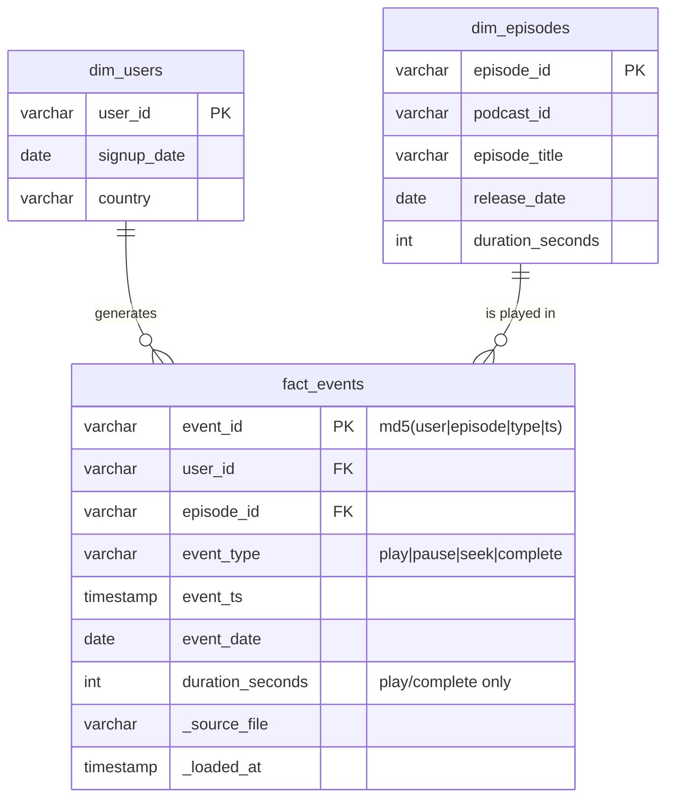

# Podcast Events Pipeline

Batch pipeline that ingests raw podcast interaction logs (JSON), cleans and validates
them with dbt, loads a star schema, and answers the engagement questions in SQL.

**Stack:** Python 3.9+, DuckDB, dbt (dbt-duckdb), Airflow DAG.

## Run it

```bash
pip install -r requirements.txt
python -m pipeline.run_pipeline      # ingest raw -> dbt build (models + tests) -> data/podcast.duckdb
python -m pytest -q                  # end-to-end tests (each runs dbt, so allow a minute or two)
```

Run an analysis query:

```bash
python -c "import duckdb; print(duckdb.connect('data/podcast.duckdb', read_only=True).sql(open('sql/analysis/q1_top10_completed_episodes_7d.sql').read()))"
```

Or use dbt directly (after the ingest step has populated `raw.event_logs`):

```bash
cd dbt_project
dbt build --profiles-dir .           # models + tests
dbt docs generate --profiles-dir .   # lineage / docs
```

Sample inputs live in `data/raw/` (`event_logs.json`, `users.csv`, `episodes.csv`). Use
`--events/--users/--episodes/--db` on the CLI to point elsewhere. Re-running is safe (idempotent).

## Layout

```
data/raw/                      sample inputs
pipeline/ingest.py             Part 2 – Python ingest of raw NDJSON into raw.event_logs
pipeline/run_pipeline.py       CLI: ingest, then `dbt build`
dbt_project/models/staging/    stg_users, stg_episodes, stg_events (cleaning + reject_reason)
dbt_project/models/core/       dim_users, dim_episodes, fact_events, events_enriched, quarantined_events (+ schema.yml)
dbt_project/tests/             singular data-quality tests (errors and warnings)
sql/analysis/*.sql             Part 3 – analysis queries (q1–q3) + q4 avg session duration
dags/podcast_events_dag.py     Airflow DAG (daily 02:00 UTC)
Dockerfile, docker-compose.yml Local Airflow (standalone) that can run the DAG
tests/                         pytest end-to-end tests
```

## Part 1 – Data model

The model is defined by the dbt models plus `models/core/schema.yml`, which enforces column
types and keys through dbt model contracts.



Also: `raw.event_logs` (untyped landing table) and `core.quarantined_events` (rejected rows
with the reason).

**Efficiency choices:** narrow fact table (integer duration, no repeated descriptive strings,
those live in the dims); `event_date` is materialised so date-range queries can prune
(partition / cluster key in Snowflake); deterministic `event_id` plus an incremental model
with `unique_key` makes loads idempotent.

## Part 2 – Pipeline

1. **Ingest** (`pipeline/ingest.py`): reads the NDJSON with every column as VARCHAR, so a bad
   value never aborts the load, into `raw.event_logs`. Re-ingesting a file replaces its rows.
2. **`stg_events`** normalises and types each row and assigns `reject_reason` (first failing
   rule): unparseable line, missing user/episode ID, invalid event type, malformed/null
   timestamp, timestamp outside 2020-01-01..tomorrow, unknown user/episode, missing duration
   on play/complete.
3. **`fact_events`** (incremental) takes valid rows; **`quarantined_events`** takes the rest, so
   nothing is silently dropped. **`events_enriched`** is the analysis-ready view: valid events
   joined to user country/signup date and episode podcast/title/length.
4. **Data quality = dbt tests** run by `dbt build`, which fails the pipeline on any error:
   - schema.yml: unique / not_null keys, relationships to the dims, accepted event types;
   - singular tests (error): reject rate ≤ 10% of the batch, timestamps in range, duration
     present only on play/complete;
   - singular test (warn): completion duration longer than the episode.

**Sample result:** 5,000 raw → 4,845 loaded, 155 quarantined (59 missing user, 41 missing
episode, 25 invalid event type, 15 missing duration, 15 malformed timestamp). One warning:
501 completions report a duration longer than the episode.

**DAG:** `podcast_events_daily` – `ingest_raw_events >> dbt_run >> dbt_test`, daily, 2 retries,
`max_active_runs=1`. Tasks are idempotent so retries and backfills are safe.

**Run the DAG in Airflow (needs Docker):**

```bash
docker compose up --build        # Airflow UI at http://localhost:8080 (login is printed in the container log)
# in another terminal – run the whole DAG once, no scheduler needed:
docker compose exec airflow airflow dags test podcast_events_daily 2024-04-30
```

The results land in `data/podcast.duckdb`, the same file the CLI writes. On Linux, if the
container can't write to the mounted folder, run `sudo chown -R 50000 .` first.

**Testing note:** I developed on Windows, where Airflow doesn't run and Docker wasn't available,
so the DAG and the Docker setup have *not* been executed in a real Airflow. What I did check:
the DAG file imports against a stub of the Airflow classes, and its three task functions, called
in order, give the same result as the CLI (4,845 events loaded, 155 quarantined).

## Part 3 – Analysis (sample output)

| Query | Result |
|---|---|
| q1 top 10 completed episodes, last 7 days | ep_19 (5), ep_24 (4), ep_45 (4), then 3s… |
| q2 avg listen-through by country | UK 0.772, FR 0.741, DE 0.713, AU 0.704, CA 0.702, US 0.697, IN 0.685 |
| q3 users with 3+ distinct episodes in a day | 13 |

## Assumptions & constraints

- **DuckDB instead of Snowflake** so it runs locally with no setup. To move to Snowflake, swap
  the dbt adapter and profile, and replace the raw ingest and the CSV `read_csv` staging with
  `COPY INTO` / dbt seeds or sources.
- **"Past 7 days" is anchored to the latest event in the data** (2024-04-30) because the
  sample data is historic; swap the anchor for `current_date` in production.
- **Listen-through rate** = `complete.duration / episode.duration_seconds`, capped at 1.0 per
  event. 501 sample completions exceed the episode length (likely synthetic data); the
  uncapped average is also shown in q2.
- **"Listened to" an episode** (q3) = a `play` or `complete` event for it.
- **Sessions** (q4): computed in the query, with a 30 min inactivity gap per user across
  episodes. The sample timestamps are random, so most sessions are single events (duration 0).
- `duration` on play/complete is treated as seconds; pause/seek duration is null by spec.
- Duplicates are identical (user, episode, type, timestamp) and collapse to one event.
- The incremental model filters on `_loaded_at`; a corrected file is reprocessed by
  re-ingesting it (replace-by-file), which upserts by `event_id`.
- Dimensions are rebuilt each run (Type 1); no history is kept for changes such as a user's country.

## What I'd do with more time

- **Run the DAG in a real Airflow** and add CI (GitHub Actions) that runs `pytest` and
  `dbt build` on every push. The DAG is only checked with a stub today (see the testing note).
- **Move to Snowflake:** dbt-snowflake profile, land raw files with `COPY INTO` / Snowpipe from
  object storage, and cluster `fact_events` on `event_date`.
- **Late-arriving data:** the incremental filter on `_loaded_at` is simple; I'd add a lookback
  window and partition-based reprocessing instead of relying on re-ingesting whole files.
- **Sessions as a model:** q4 computes sessions on the fly; at real volume it should be an
  incremental dbt model, and the 30-minute gap agreed with the product team.
- **Better reject reporting:** record every rule a row fails, not just the first, and alert on
  warning-level tests rather than only failing on errors.
- **Clarify the data:** 501 completions are longer than the episode. I'd confirm what
  `duration` means for `complete` events before trusting the listen-through rate.
- **Dimension history:** use a dbt snapshot (SCD2) for users, so country changes don't rewrite
  past results.
